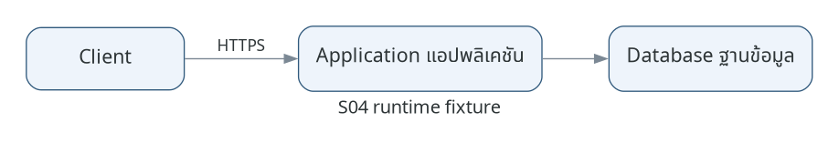

# S04 Desktop Host Check: Historical Docker Pilot

Recorded: 2026-11-01T15:50:12.634270+07:00 | Scope: M0-02/M0-05, synthetic three-node fixture only.

Live installed-plugin calls, inline PNG content and complete local artifact retrieval passed in this desktop chat. The established executor is **Codex Desktop**, running inside the installed app whose display name is ChatGPT. A distinct ChatGPT Work UI mode, host UI preview and download clicks remain unverified. This evidence does not close M0 or establish another host mode.

## Checkout and constraints

- Repository: `/Users/visarut.pha/Documents/source/easybuy/mingrammer-diagram`.
- Branch: `codex/s04-runtime-proof`; observed/expected HEAD: `720831733bdb99061f62f7d509d95a65aa7f748b`.
- Base: `afbaccad87019d35bff12d335ec534166752f0bf`, verified as an ancestor of HEAD.
- Initial working tree was clean. Every existing tracked file matched HEAD before evidence creation. Source, existing documentation and published S04 proof snapshots were not edited.
- Only this report, [structured proof](S04-work-host-proof.json), and unique fixture PNG/SVG evidence copies were authored. The requested renderer created its normal bundle under its existing output root.
- No branch/worktree changes, commit, push, merge, deployment, account-plugin creation/upload, central server, setup rerun, version/configuration changes or messages to other chats were performed.

Read first: `HANDOFF.md`, S04 runtime/hosting evidence and the published runtime/local-plugin proof JSON. The installed `cloud-architecture-runtime` skill from the then-installed alpha.1 cache was applied.

## Established execution host

| Observation | Result |
|---|---|
| Local executor environment | `CODEX_INTERNAL_ORIGINATOR_OVERRIDE=Codex Desktop`, `CODEX_CI=1` |
| Current chat ID | `01a1964a-784d-7751-bfe5-57e0bbb4cf39` |
| App bundle inspected | `/Applications/ChatGPT.app/Contents/Info.plist` |
| App display name / bundle ID | `ChatGPT` / `com.openai.codex` |
| App version / build | `26.1027.30824` / `22943` |
| Bundled CLI | `codex-cli 0.166.0-alpha.5.1` |
| Process ancestry | Local shell -> bundled `codex` PID 31288 -> app `ChatGPT` PID 31190 |
| OS / architecture | macOS 27.0.1 build 26A434 / ARM64 |
| Computer Use inventory | Running `ChatGPT` app with ID `com.openai.codex` |

The first speculative `/Applications/Codex.app/Contents/Info.plist` lookup found no app metadata; the verified bundle path above came from the existing setup instructions and process ancestry. The environment, local file access and actual Docker image establish local execution. The app display name and shared CLI ancestry do not prove a particular Work UI mode.

`mcp__cua_repl.js` call `await cua.getApp('com.openai.codex')` returned exactly:

> Computer Use is not allowed to use the app 'com.openai.codex' for safety reasons.

No bypass was attempted. Host UI inspection and user clicks on the final file links could not be observed. This is a live desktop-chat tool test, beyond the earlier SDK harness, with the specific Work-mode acceptance still open.

## Plugin and runtime identity

- Installed plugin: `cloud-architecture-diagrams@mingrammer-local`, version `0.1.0-alpha.1`.
- Cache: `/Users/visarut.pha/.codex/plugins/cache/mingrammer-local/cloud-architecture-diagrams/0.1.0-alpha.1`. Portable and legacy manifests identify the same version and require a local executor; stdio launcher is `python3 ${PLUGIN_ROOT}/scripts/launch.py`.
- Existing immutable image: `sha256:0e79c3b7f66f0400d89cf7d4d97c1515e52cc954f9b1b562a1784d4de5f16f30`; Linux ARM64.
- Existing runtime-source fingerprint: `8a92c48a321509f145b0d111a6cfd7d5b51960966884c70f3c3b60275eb1bc20`. Installed runtime files, stored state and image provenance label matched.
- Runtime state: `/Users/visarut.pha/.local/share/cloud-architecture-diagrams/0.1.0-alpha.1.json`; SHA-256 `fd1b1452f4679c99c82e20a0d9fb9a8deac19b67af79a206848d303ee25c656a`. Read only, no setup rerun.
- Docker Engine 29.9.2 / Docker Desktop 4.97.0 (244584).
- Actual tool-reported runtime: Python 3.13.13; diagrams 0.25.1; Graphviz 12.2.1; Python graphviz 0.20.3; MCP SDK 2.3.0; Linux aarch64; UID 501. Fonts: Noto Sans 2.015 and Noto Sans Thai 2.002, with actual font hashes in structured proof.
- Three running pilot containers used the same installed image. Two Docker processes shared the current CLI parent; exact per-tool container attribution was not established. Inspected candidates used user `501:20`, network `none`, read-only root, dropped capabilities, no-new-privileges, 1 CPU, 1 GiB/no extra swap, 64 PIDs and 256 MiB tmpfs. Their only host bind was the existing output root. No container was stopped or altered; disconnect cleanup was not tested here.

## Actual tool calls

The names below were discovered from the available tool registry, whose descriptions identified the installed Cloud Architecture Diagrams (S04) plugin. No tool name was guessed and no SDK harness was used for the rendering/read calls.

1. `mcp__architecture_runtime__get_runtime_info({})` succeeded first.
2. `mcp__architecture_runtime__render_fixture` succeeded with this literal input:

```json
{"request":{"labels":["Client","Application \u0e41\u0e2d\u0e1b\u0e1e\u0e25\u0e34\u0e40\u0e04\u0e0a\u0e31\u0e19","Database \u0e10\u0e32\u0e19\u0e02\u0e49\u0e2d\u0e21\u0e39\u0e25"]}}
```

3. `mcp__architecture_runtime__read_fixture_artifact` succeeded once for each of `diagram.svg`, `diagram.png`, `source.json`, `source.dot`, and `manifest.json`, using returned bundle ID `dd12797b1c044f7e33239cc9cf8b3752`. Five independent reads returned embedded resource blobs under `artifact://` URIs.

All seven plugin calls returned `isError=false`; no plugin/tool runtime error occurred. The renderer's static `work_host: not_tested` and `production_semantics: not_tested` fields were retained verbatim. They do not independently determine the observed host mode.

## Complete artifact export and equality checks

Bundle directory: `/Users/visarut.pha/Documents/CloudArchitectureDiagrams/dd12797b1c044f7e33239cc9cf8b3752`.

Historical host-only directory: `/Users/visarut.pha/Documents/CloudArchitectureDiagrams/dd12797b1c044f7e33239cc9cf8b3752/`. The original files were `diagram.png`, `diagram.svg`, `source.json`, `source.dot` and `manifest.json`. This path records provenance and is not a portable repository dependency; use the repository-relative PNG/SVG evidence copies below.

| Artifact | Bytes | SHA-256 |
|---|---:|---|
| `diagram.svg` | 3,071 | `07b037bae720868ad9701fb317989c485177f1bdf0d78e8f8304c51f7bd868b2` |
| `diagram.png` | 20,294 | `3cbd22a640f1b0788698175cc0fc75bbf13471e132cb2154740c6b4a9e99a301` |
| `source.json` | 211 | `8f9fd1c6fbb2ffffb673b1d128d2ffe38d98ffecdd39ca4f1019258aed8aad88` |
| `source.dot` | 800 | `43943b991621592b0b2fcc4efdcb774974a59521081bc833a2bdc98375546fe4` |
| `manifest.json` | 3,287 | `43d3d0378d37024eeb5da16ba577b0eea1bbf61da56eb255fabf39fdc1aad5a6` |

Every complete tool-returned blob was base64-decoded and compared byte-for-byte with its returned absolute local file. All five comparisons passed. All four payload files matched both render-result and manifest byte counts/SHA-256 values. The manifest has no self-checksum; its hash above was computed independently and its tool/local bytes matched. The manifest bundle ID and exact source labels matched the request.

The renderer returned one inline PNG image. Its decoded bytes matched the PNG from `read_fixture_artifact` and the local file. PNG dimensions are 918 × 168; fixed graph size is three nodes/two edges. Reported render time was 0.0509 seconds, excluding startup/transport; this single synthetic result is not a performance guarantee.

## Visual inspection and preview limits

The original inline PNG and the local PNG were visually inspected: Client -> Application with its literal Thai label -> Database with its literal Thai label, two arrows, HTTPS text and S04 caption were visible, with readable text and no observed clipping.

The local image viewer initially returned a `data:application/octet-stream;base64,` URL, which displayed a blank strip. Changing only that in-memory URL MIME to `image/png` made the same bytes display clearly. No image content or source file was changed.



Evidence copies: [PNG](S04-work-host-fixture-dd12797b1c044f7e33239cc9cf8b3752.png) · [SVG](S04-work-host-fixture-dd12797b1c044f7e33239cc9cf8b3752.svg); copied bytes and hashes equal the original bundle.

The final chat response supplies a native local PNG embed and all five absolute file links. The actual MCP image content was displayed in tool output; final host UI preview rendering and user download clicks were not observable because app inspection was blocked. No ZIP was created within the restricted evidence-write scope.

## Remaining proof

ChatGPT Work UI mode/preview/download acceptance, other host modes, second-machine reproduction, SVG font portability, provider/Kubernetes semantics, stress/transport limits, independent review and owner acceptance remain open. This test does not mark M0-02/M0-05 or S04 complete. Existing handoff/status documents and published proof snapshots were intentionally left unchanged.

Final read-back validation at 2026-11-01T23:22:22.998290+07:00: branch/HEAD, all existing tracked files, four baseline evidence hashes, runtime state, cached package content, five original artifacts, two evidence copies and complete bundle links passed. Only four new evidence files were authored.
