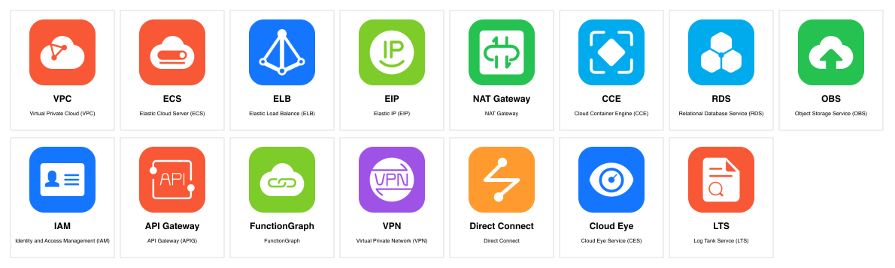
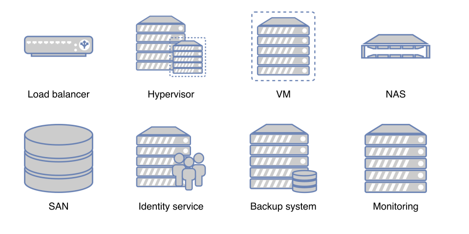

# S06 — Provider Semantics, Catalogs and Icon Rights

Date: 2026-11-02 | Tasks: M2-01..06 | Branch: `codex/s06-provider-catalogs`, from `c6a59e5` | Updated for owner decisions D-016 to D-019

**Status update after independent review:** Astra/High found five P2 issues at `5569459`; the owner then requested fixes. After the [fixes](S06-review-fixes.md), Claude Fable 5.1 / High [reviewed them](S06-fable-review.md) under D-020 and approved `5f391eb`, which passes actual CI with 12 lanes / 652 tests. M2 closed on 2026-11-03, and D-019 closes the asset-rights exit item for the private personal release. The implementation results below are the record from before that review; the exit criteria and next steps are kept current.

**Later change:** this record describes catalog `2026.11.0`. [S12](S12-aws-ecs-lambda-waf.md) adds five AWS types as catalog `2026.11.1`, and [S13](S13-aws-next-types.md) adds 16 more as `2026.11.2`. Those pages were checked on 2026-11-05.

**Result: the catalogs, semantic rules, on-premises assets and both new gate lanes are implemented, along with the owner's decisions D-016, D-017 and D-018, and actual CI passes at `6929253`. M2 closed on 2026-11-03** for the private personal release, after the [fix review](S06-fable-review.md) approved `5f391eb`.

## Task status

| Task | Status | Result |
|---|---|---|
| M2-01 | Complete | 26 frozen taxonomy IDs, 148 catalog records in catalog `2026.11.0`, and a machine-readable inventory of all 93 items named in requirements section 6 |
| M2-02 | Complete | AWS, Azure and GCP native types, native IDs and documented placement rules, with fixtures |
| M2-03 | Complete for private personal use only | Huawei types, native service codes, IAM and enterprise-project distinctions and per-service rules are complete. **All 15 items that need an icon have one, for private personal use only under D-018, with rights not cleared.** The owner accepted the icon sheet |
| M2-04 | Complete, contact sheet accepted by the owner | Physical and logical on-premises types, plus the eight D-010 representations with exact source conditions, attribution and original and derived hashes |
| M2-05 | Complete | The `catalog-license` lane runs real inventory, license, asset and evidence checks, and fails on missing rights or assets |
| M2-06 | Complete | 22 Kubernetes kinds, 11 cluster modes with node-pool mappings, and rules applied on all five hosting environments |

## Exit criteria

| Criterion | State |
|---|---|
| All five hosting inventories and the Kubernetes detail catalog meet minimum breadth | **Met.** A test parses the requirements table, so the inventory cannot drift from it |
| Rules have evidence | **Met.** All 59 rules cite sources: provider or Kubernetes documentation for provider behavior, and the requirements for project-defined checks. All 132 source pages were fetched, and 79 specific claims matched, on 2026-11-02 |
| Asset rights are established | **Settled by the owner for the private personal release (D-019).** As written it is not met for Huawei: D-018 accepts the risk for private personal use and establishes no rights. Requirements section 6.2 says that when rights cannot be established, a blocker is recorded and scope is discussed, and O-002 and D-018 do that. On 2026-11-03 the owner decided this satisfies the exit item, because the owner will not distribute publicly. The other packs are recorded below with their real strength of evidence |
| No Huawei completion through unapproved icons or undisclosed generic replacements | **Met.** Tests reject both, Huawei is not marked complete, and icons appear only as the owner decided, with their limit disclosed |
| Astra/High review | **Performed at `5569459`, with changes requested** ([review](S06-astra-review.md)). The fixes are at `dc54b4d` ([fix evidence](S06-review-fixes.md)). Claude Fable 5.1 / High reviewed them as a substitute under D-020 ([fix review](S06-fable-review.md)) and **approved `5f391eb`** after F5 was found only partly fixed and N1 was fixed |
| Owner inspection (session plan, not an exit item) | The eight on-premises symbols and the 15 Huawei icons are accepted on their sheets. **Kubernetes representations have not been shown to the owner.** No Kubernetes sheet exists yet, and rendered detail views come with M4-05 |

## Validation

Actual Quality gate [run 41473877379](https://github.com/Rabcat-dome/mingrammer-diagram/actions/runs/41473877379), job 125374227725, passed all 12 lanes at `69292536c45c44ceffb3b5cf08fc8dbd9248b69a`, from a clean checkout on the self-hosted runner `macbook-pro-m2-max-mingrammer` with Python 3.13.7. The 520 tests include none skipped, and the job has zero annotations. The repository-visibility guard read `private` from the run's event. The wheel it built has the same SHA-256 as the local build, `cbf63432...3875`, and carries the upload-block classifier and the 30 Huawei files. Earlier stages also passed actual CI: [run 41462453632](https://github.com/Rabcat-dome/mingrammer-diagram/actions/runs/41462453632) with 480 tests at `4b9b826`, and [run 41467781802](https://github.com/Rabcat-dome/mingrammer-diagram/actions/runs/41467781802) with 514 tests at `9d579f8`.

The counts below are from run 41473877379:

| Lane | Tests | Work done |
|---|---|---|
| `schema-core` | 91 | Existing core tests, updated for the new result scope |
| `catalog-license` (new) | 72 | Script checks on the real repository, then tampering tests, including guessed Huawei mappings and clearance claims |
| `provider-semantics` (new) | 310 | 13 positive models, 276 expanded negative cases, warning cases and coverage tests |
| `claude-plugin` | 47 | Package contract and clean-copy runtime, including catalog data in the copy |

A test lane now fails if it runs no tests, and the gate report carries `release_blockers`, so a green gate cannot read as release clearance.

Sabotage checks confirmed the lanes do real work. Each change was made to the real repository, failed its lane and was restored, with the `src` tree digest identical afterwards:

| Change | Lane result |
|---|---|
| An unlisted `huawei-ecs.png` placed under `src` | `catalog-license` failed: asset not in the rights manifest |
| ALB loses its two-zone rule | `provider-semantics` failed on `aws-alb-subnets-same-zone` |
| Huawei ECS given a generic native class | `catalog-license` failed: Huawei services must not use a substitute |
| AWS subnet changed to regional | `provider-semantics` failed three cases |

The real wrapper in `plugins/cloud-architecture-diagrams/bin/cloud-diagrams` ran from a fresh private environment that holds no `diagrams` package: capabilities, a filtered catalog search, a valid Huawei model with one `ASSET_PRIVATE_USE_ONLY` warning, and a model with Thai labels. The owner's installed plugin, S04 alpha.3, the Codex marketplace and the runner registrations were not changed, so the installed Claude plugin does not have this work yet.

## Catalog design

Catalog data lives in `src/cloud_architecture_diagrams/catalog_data`, so it ships with the wheel and reaches the Claude plugin through its link. [The contract guide](../../design/core-contract.md#catalogs-and-provider-semantics) describes it, and `schemas/catalog-v1.schema.json` publishes its record format.

| Provider or platform | Records | Representation |
|---|---|---|
| AWS | 22 | 13 native classes, 9 labeled boundaries |
| Azure | 23 | 13 native classes, 9 labeled boundaries, 1 labeled node |
| GCP | 24 | 16 native classes, 8 labeled boundaries |
| Huawei Cloud | 25 | 16 private-use assets, 9 labeled boundaries, one of which carries the VPC icon |
| On-premises | 23 | 8 custom assets, 6 native classes, 9 labeled boundaries |
| Kubernetes | 22 | 18 native classes, 3 labeled boundaries, 1 labeled node |
| Common and external | 9 | Logical boundaries and external parties |

Choices made while freezing the inventory:

- **Product variants have their own types** where the difference changes a rule: zonal and regional AWS NAT gateways, three GCP load-balancer products, GKE Standard and Autopilot, CCE standard, Turbo and Autopilot.
- **`external.entity` is new.** FR-024's external parties had no taxonomy ID, so requirements revision 0.10 adds one.
- **`security_group` is a new boundary kind**, so AWS security groups, Azure NSGs and Huawei security groups stay distinct from a logical `security_zone`. The change is additive, so the schema stays at 1.0.0. A GCP VPC firewall rule stays a resource, because it is not a membership boundary.
- **Native IDs** use CloudFormation types for AWS, ARM types for Azure, Cloud Asset types for GCP and API group and version for Kubernetes. Each was checked against its reference page. Huawei records use the documented service code, because no equivalent resource-type reference was verified.

## Rules that older assumptions would have got wrong

Checking current sources changed several rules from what the requirements and memory suggested:

- AWS **regional NAT gateways** sit on the VPC with no public subnet, so a rule requiring a subnet would reject a valid design. They are now a separate type from zonal gateways.
- An EC2 instance **may** attach to several VPCs through its interfaces, so the rule is that its interfaces share one zone, not one VPC.
- Azure **Standard NAT Gateway is zonal and StandardV2 is zone redundant**, so `zone_ref` stays optional.
- GKE **Autopilot clusters are always regional**, and a node pool is documented as a Standard-cluster concept. CCE Autopilot is documented as serverless with no node management. Declaring a user node pool in either fails.
- Huawei **OBS and IAM are authorized globally** in Huawei's service table, although a bucket has a region. Authorization scope and location are separate, so OBS rejects an IAM project and keeps its region.

Some documented points are deliberately not enforced, because a false rejection would be worse than a gap:

| Not enforced | Why |
|---|---|
| RDS subnet group across two zones | AWS says "should", and listed subnets may not be the whole group |
| Azure `GatewaySubnet` and `AzureFirewallSubnet` names | `name` is a free display label, so a rule would reject a readable one |
| Node pools in EKS Auto Mode and AKS Automatic | The pages reviewed do not clearly forbid them, so only a warning about declared nodes applies |
| Azure NSG same-region association | No statement was verified |
| Huawei tag syntax, and one enterprise project per resource | No statement was verified |

Nothing here checks a live account, so a passing model is not proof of deployment, reachability or enforcement.

## Icon rights

The structured record is `src/cloud_architecture_diagrams/catalog_data/assets.json`, and `assets/NOTICE.md` ships with the package.

| Pack | Delivery | Evidence and its strength |
|---|---|---|
| draw.io Network 2018 | **Bundled**, 8 SVG and PNG pairs | CC BY 4.0 at the pinned source, with the stencil license's Atlassian restriction. Applies to the seven audited shapes only |
| AWS | `diagrams` dependency | [Explicit permission](https://aws.amazon.com/architecture/icons/) to create architecture diagrams, recognizing third-party libraries |
| Azure | `diagrams` dependency | [Explicit permission](https://learn.microsoft.com/en-us/azure/architecture/icons/) for architectural diagrams, training material and documentation. No cropping, flipping, rotating or distortion, so M3 must draw them unmodified |
| GCP | `diagrams` dependency | [Weaker](https://cloud.google.com/icons): the official library offers them for diagrams and technical documentation, with no license text. Accepted by the owner under D-016, citing [upstream coverage](https://diagrams.mingrammer.com/docs/nodes/gcp). That reason is coverage, so it adds no license |
| Kubernetes | `diagrams` dependency | [Apache-2.0 or CC-BY-4.0](https://github.com/kubernetes/community/blob/309fa9adfc84a8d04b0817a8b11124bf479a8d5e/icons/README.md). The `diagrams` copies are 256-pixel files, not byte-identical to the 128-pixel community PNGs, so a visual sample matches but exact origin is not proven |
| Generic and on-premises | `diagrams` dependency | MIT, with no per-icon origin recorded upstream |
| Huawei Cloud | **Bundled for private personal use only**, 15 SVG and PNG pairs | Owner risk acceptance under D-018. **Not cleared.** See [below](#huawei-cloud-icons-under-d-018) |

`native_icons.json` locks the file and SHA-256 behind all 62 allowed classes in the pinned `diagrams` 0.25.1 wheel, and the lane compares them with the installed package. `diagrams` is a development dependency for now, so the plugin's runtime stays unchanged until M3. Upstream copies may be older than each provider's current set; FR-048 and M4 check that.

### Huawei Cloud icons under D-018

**The owner decided on 2026-11-02 to use the color group of `huaweicloud-latam/drawio-libraries`, for private personal use only.** D-018 records this as the owner accepting the rights risk for that use. It is not permission from any rights holder: rights are not cleared and redistribution permission is not established. O-002 keeps public distribution blocked.

This set replaces the earlier pack, as the owner confirmed through the parent session, so the two families are not mixed. S02 had also advised against mixing them.

**Source facts, unchanged by the decision:**

| Fact | Value |
|---|---|
| Repository and pin | `huaweicloud-latam/drawio-libraries`, commit `52c33aa12fb816a5de403da85067e1c0f039b5be`. Upstream confirms on 2026-11-02 that this is both `main` and the commit of tag v3.2, released 2025-01-31 |
| Files | Six color libraries; each Git blob and SHA-256 is in `assets.json` and `S06-latam-pack-inventory.json`. Blobs match S02 |
| Publisher | A GitHub organization named HUAWEI CLOUD LATAM that links to Huawei Cloud. It is not verified, and corporate authorization is not established |
| License | No license file, and GitHub reports none. The [README](https://github.com/huaweicloud-latam/drawio-libraries/blob/52c33aa12fb816a5de403da85067e1c0f039b5be/README.md) says this group holds the icons seen in the console and product pages, and it grants nothing |
| Actual format | The 15 mapped icons are SVG in base64 inside draw.io mxlibrary files, viewBox 72x72, 0.7 to 1.7 KB each, using only `svg`, `g`, `path`, `rect`, `defs`, `clipPath` and `desc`. A scan of all 15 color libraries, 254 SVG and 8 group entries with every blob matching, found no scripts, links, embedded images or external references |
| Actual appearance | Color icons on rounded tiles, with a white glyph on a solid color |

**Coverage of the 17 required items:**

| State | Items |
|---|---|
| **Mapped (15):** the library's title names the service | VPC, ECS, ELB, EIP, NAT Gateway, CCE, RDS, OBS, IAM, API Gateway, FunctionGraph, VPN, Direct Connect, Cloud Eye, LTS |
| **Labeled boundary (2):** no icon needed under section 6 | Subnet, Security Group |
| **No clear match** | None |

Each mapping pins a library, an index and an exact title, all matching S02's record. Details worth a look:

- **CCE:** the library has one CCE icon, so standard, Turbo and Autopilot clusters share it and keep their own labels.
- **RDS:** the general RDS icon is used, not the separate MySQL, PostgreSQL, MariaDB or SQL Server variants, because the model does not state an engine.
- **LTS:** the upstream title has a typo, `Log Tank Servce (LTS)`. Provenance keeps it, and the label reads Log Tank Service.
- **Subnet and Security Group:** S02 counted these among its 17 candidates, but no color library has an SVG icon for either. They appear only as mxGraph group definitions in `HWC Groups.xml`, which were not imported, so boundaries are drawn from the model. Section 6 allows a labeled boundary for group items.

Each SVG is byte-identical to its decoded entry. Each 256x256 PNG is rasterized from it with rsvg-convert 2.63.4, and both digests are recorded. `S06-latam-pack-inventory.json` lists the 90 entries in the six libraries with no artwork, and `scripts/build_huawei_assets.py` refuses a library that differs from its pin.

**How the limits are enforced.** The `catalog-license` lane fails when any of these breaks:

- The package lacks `Private :: Do Not Upload`, which PyPI rejects on upload. The `package-contents` lane checks the built wheel for it as well.
- In Actions, the event reports the repository as public. CI run 41473877379 read `private`. Outside Actions the visibility cannot be read, and the report says `not_checked_outside_actions`.
- The private pack claims a license or redistribution evidence, loses its pinned files, or names a decision that does not say private personal use. A pack also cannot become `approved` on owner risk acceptance.
- A source title does not name the service, so mapping OBS to a generic storage icon fails.
- A bundled icon is not used by any catalog type, which a test also requires.
- `NOTICE.md` or the plugin README stops stating the limit.

Sabotage checks confirmed three of these on the real repository under D-018: a reported-public repository, a removed classifier, and OBS given the title `storage-55` each failed the lane, and the files were restored. These guards catch mistakes in the repository. They cannot stop someone copying the files, and the lane only runs when a job does, so flipping the repository to public would be caught at the next run, after the fact.

**Owner inspection:** on 2026-11-02 the owner reviewed this icon sheet and accepted it, as relayed through the parent session. The acceptance covers [this sheet](S06-huawei-icon-review.png) only, SHA-256 `959b8b22f6ff93e328a4dacc9d4f27971a55a431360ee25d7252224cc8f1d35e`. Rendered visual acceptance stays with M4 and M6. This is visual acceptance only, so it changes nothing about D-018 or O-002: rights are not cleared, and public distribution stays blocked.

**What this leaves for the owner:**

1. **Git history:** the JuanDiaz00 images are in this branch's history from `9d579f8`, and the LATAM images from `6929253`. Making the repository public would first require removing them from history.
2. **Generated diagrams:** sharing an image that shows these icons outside private use is not covered by D-018.

Written consent from Huawei remains the only route to public distribution. Draft request, not sent:

> Please identify the license or permission that applies to the Huawei Cloud service icons in huaweicloud-latam/drawio-libraries (commit 52c33aa) and at https://open.huaweicloud.com/openplatform/icons. We plan to use them in an architecture-diagram plugin: storing the files, converting formats locally, bundling them with the plugin, and producing downloadable diagrams that show them. Please confirm the permitted uses and any attribution, trademark or modification conditions, in writing.

**The earlier pack.** D-017 first chose `JuanDiaz00/Huawei-Cloud-draw.io-icons` at commit `ea52d73`, with blob `0bd2606...` and file SHA-256 `1afc1f2a...`. Measurement showed all 155 entries are RGBA PNG, 154 at 256x256 and one at 512x512, and all are pure black line art on transparent. Eight of the 17 items had a clear title there, and seven did not. Comparing the two sets supports those calls: LATAM's FunctionGraph glyph matches the `computing-fgs` entry mapped through Huawei's documented `FGS` code, while its OBS icon is nothing like `storage-55`, which was left unmapped. `S06-juandiaz-pack-inventory.json` keeps that pack's metadata.

**Other sources, unchanged:** Huawei operates an [official icon library](https://open.huaweicloud.com/openplatform/icons) with a manifest of 196 logos, SHA-256 `2862d932cdaff5ca1407910d5b0a85cf826cbda9b5576e93d0291626208f1f69`, generated 2026-07-31, with every architecture icon marked as planned and no license field. The [Huawei Cloud site terms](https://www.huaweicloud.com/intl/en-us/declaration-sg/sa_st.html) require prior written consent to reproduce, modify or distribute site content and express written permission for logos, and [Huawei's corporate terms](https://www.huawei.com/en/legal) say the same. This is a reading of published terms, not legal advice.

## On-premises representations

| Concept | Source symbols | Representation |
|---|---|---|
| Load balancer | `mxgraph.networks.load_balancer` | Direct |
| Hypervisor | `server` + `virtual_server` | Host with a guest symbol, distinct from the VM asset |
| VM | `virtual_server` | Direct, labeled VM |
| NAS | `nas_filer` | Direct |
| SAN | `storage` | Storage symbol labeled SAN |
| Identity service | `server` + `users` | Server with a people symbol; implies no product |
| Backup system | `server_storage` | Server and storage; no tape imagery |
| Monitoring | `server` | Server with a required Monitoring label, not a display symbol |

**Source correction:** S02 called `bc0ccab` a commit, but it is the annotated tag object for v29.3.2. The commit is `48b181339578e11da7052ebf5b1fba8499418b77`. The audited blobs are unchanged: `networks.xml` is `24191cc` and its SHA-256 is `2921086e...3711`. That file is no longer published at the current v32.6.9 tag, so the pinned version stays the source. The current README widens the Atlassian restriction, which does not reach this project's targets.

`scripts/build_onprem_assets.py` is a small stencil interpreter with no third-party input. `assets-source/drawio/networks-subset.xml` keeps the seven shapes verbatim, so the lane repeats the SVG derivation with no network and compares it byte for byte, and each shape's canonical digest is recorded. PNGs were rendered once with rsvg-convert 2.63.4, and the lane checks their recorded digests, signature and size. SVGs pass an allowlist with no scripts, external references or links. 

**Owner inspection:** on 2026-11-02 the owner reviewed all eight symbols on this contact sheet and accepted them, as relayed through the parent session. The acceptance covers [this sheet](S06-onprem-contact-sheet.png) only, SHA-256 `eb52f3bc5f9de8dd724f0ba8374daebcbcee9cd13105dd756981bd38a9537913`. Rendered visual acceptance, including how these look at diagram size, stays with M4 and M6.

## What later milestones depend on

- **M3** must honor `representation`, including `required_label` for assets, and must not substitute for `blocked`. Azure icons must be drawn unmodified. A bundle using Huawei icons must carry the private-use limit in its manifest.
- **M3** moves `diagrams` to a runtime dependency, which changes the plugin's locked environment and needs its test updated.
- **M4** checks native icons against current provider sets under FR-048. S01's visual fidelity remains unproven.
- **M7-04** catalog discovery is available through the plugin. Rendering remains.

## Limits

- Sources were checked once on 2026-11-02. Nothing re-fetches them automatically, so `S06-source-checks.json` is a dated record.
- The claim patterns show that a statement was present on a page. Reading it correctly was this session's judgment, with no independent review.
- Rules cover documented constraints for the minimum catalog, not every provider constraint.
- `S06-source-checks.json` hashes reduced page text rather than storing it. Provider pages change often, so a later hash mismatch would not itself show that a rule is wrong.

## Model and review

Implementation used **Claude Opus 5.5 (`claude-opus-5-5`)**, the model of the session the owner started, with a reasoning-effort setting of 100 and no named level shown. The project policy names Sol for implementation; this deviates from that and no setting was changed.

Self-checks in this session are not a review. Astra/High later reviewed `5569459` and requested changes, and Fable reviewed the fixes under D-020 and approved `5f391eb`. Review of the M7 Medium and Low fixes also remains outstanding from earlier work. It is not part of this task.

## Next steps

1. M2 is closed. N2-N4 remain deferred P3 findings; see the [fix review](S06-fable-review.md#follow-up-n1-fix-and-deferrals).
2. The owner settled the asset-rights exit item under D-019.
3. Update the owner's installed plugin only if asked. It follows `main` and holds `3d235fa`, which has this work.
4. S07 / M3 can proceed in parallel.
