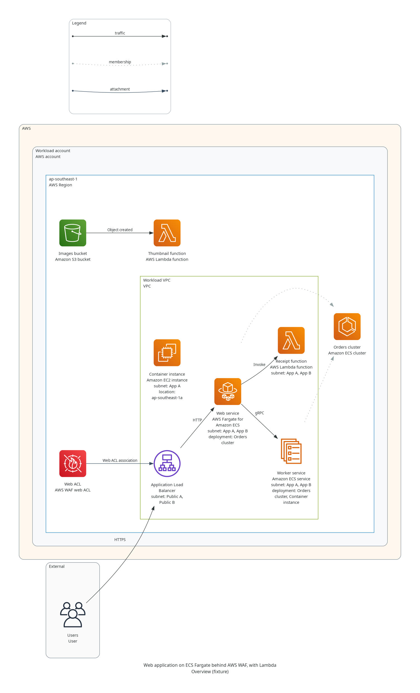

# S12 — AWS ECS, Fargate for ECS, Lambda and WAF

Date: 2026-11-05 | Branch: `codex/aws-ecs-fargate-lambda-waf`, from `a4bf065`, with `main` merged at `0aa040f` | Decision: D-036

**Result: strict validation and rendering now accept five new AWS types, each with one taxonomy ID, a placement rule from AWS's own pages and AWS's own icon. The branch is pushed and not merged, the tag `v0.1.0-alpha.1` does not move, and no live session has used it yet.**

## Why

[M7's live sessions](M7-claude-plugin.md#what-real-use-found) ended two of two AWS requests as lenient drafts, because the catalog had no ECS, Lambda or WAF, and Fargate only as the EKS profile. These sat outside the P0 list, so this is selected P1 coverage, and the inventory in requirements section 6 does not change.

The gap was confirmed before editing, with `cloud-diagrams catalog --provider aws --query <term>` at `a4bf065`: `ecs`, `lambda` and `waf` returned no records, and `fargate` returned only `aws.containers.eks_fargate_profile`.

## The types

| Type | Native ID | Taxonomy | Icon class in `diagrams` 0.25.1 | Location | Network |
|---|---|---|---|---|---|
| `aws.containers.ecs_cluster` | `AWS::ECS::Cluster` | `compute.containers` | `aws.compute.ElasticContainerService` | Regional | None |
| `aws.containers.ecs_service` | `AWS::ECS::Service` | `compute.containers` | `aws.compute.ElasticContainerServiceService` | Regional | One VPC, at most 16 subnets |
| `aws.containers.ecs_fargate` | `AWS::ECS::Service` | `compute.containers` | `aws.compute.Fargate` | Regional | One VPC, at most 16 subnets |
| `aws.compute.lambda` | `AWS::Lambda::Function` | `compute.serverless` | `aws.compute.Lambda` | Regional | Optional: one VPC, at most 16 subnets |
| `aws.security.waf` | `AWS::WAFv2::WebACL` | `security.control` | `aws.security.WAF` | Regional | None |

The brief named ECS as "cluster or service". Both are here, because they follow opposite network rules and a request usually names both. **No other type was added.** Fargate shares `AWS::ECS::Service` with the general service, as the NAT gateway variants share one native ID, because the difference changes a rule: Fargate has no EC2 host.

The catalog gained one capability, `container_workload`, because no existing one described a service, and one placement field, `attachment_targets`. Both are additive, so the schema stays at 1.0.0. Five rule codes are new: `PLACEMENT_HOST_REGION_MISMATCH`, `PLACEMENT_ATTACHMENT_TARGET_INVALID`, `AWS_ECS_CLUSTER_MULTIPLE`, `AWS_WAF_RESOURCE_REGION_MISMATCH` and `AWS_WAF_ACL_MULTIPLE`.

## What each rule rests on

Each page was fetched on 2026-11-05 and is recorded in `S06-source-checks.json`, where these 16 pages carry their own `checked` date. The patterns there match the page text, as in S06. The quotes below are AWS's.

| Rule | AWS says | Source |
|---|---|---|
| An ECS cluster is one logical, regional group | "logical grouping of tasks or services"; "Clusters are AWS Region specific" | [Clusters](https://docs.aws.amazon.com/AmazonECS/latest/developerguide/clusters.html) |
| A cluster takes no network | Its seven properties name no VPC or subnet | [`AWS::ECS::Cluster`](https://docs.aws.amazon.com/AWSCloudFormation/latest/TemplateReference/aws-resource-ecs-cluster.html) |
| A workload's subnets share one VPC, at most 16 | "All specified subnets must be from the same VPC"; "limit of 16 subnets" | [AwsVpcConfiguration](https://docs.aws.amazon.com/AmazonECS/latest/APIReference/API_AwsVpcConfiguration.html) |
| A service names one cluster | "the cluster that you run your service on" | [`AWS::ECS::Service`](https://docs.aws.amazon.com/AWSCloudFormation/latest/TemplateReference/aws-resource-ecs-service.html) |
| A service may run on an on-premises host | "registering an external instance such as an on-premises server" | [ECS Anywhere](https://docs.aws.amazon.com/AmazonECS/latest/developerguide/ecs-anywhere.html) |
| Fargate has no EC2 host | "without having to manage servers or clusters of Amazon EC2 instances" | [AWS Fargate](https://docs.aws.amazon.com/AmazonECS/latest/developerguide/AWS_Fargate.html) |
| Fargate means subnets are meaningful | "the awsvpc network mode is required" | [RegisterTaskDefinition](https://docs.aws.amazon.com/AmazonECS/latest/APIReference/API_RegisterTaskDefinition.html) |
| A function's subnets share one VPC, at most 16 | "security groups and subnets in the VPC"; one `VpcId`; 16 items | [`AWS::Lambda::Function`](https://docs.aws.amazon.com/AWSCloudFormation/latest/TemplateReference/aws-resource-lambda-function.html), [VpcConfigResponse](https://docs.aws.amazon.com/lambda/latest/api/API_VpcConfigResponse.html), [VpcConfig](https://docs.aws.amazon.com/lambda/latest/api/API_VpcConfig.html) |
| A function is regional, and a zone does not apply | "Lambda runs your function in multiple Availability Zones" | [Resilience](https://docs.aws.amazon.com/lambda/latest/dg/security-resilience.html) |
| A web ACL protects only listed types | "You can protect the following resource types" | [What is AWS WAF](https://docs.aws.amazon.com/waf/latest/developerguide/what-is-aws-waf.html) |
| A regional web ACL shares its resource's Region | "must be in the same region as your resource" | [Associating](https://docs.aws.amazon.com/waf/latest/developerguide/web-acl-associating-aws-resource.html) |
| One web ACL for each resource | "with only one" protection pack (web ACL) | [Associating](https://docs.aws.amazon.com/waf/latest/developerguide/web-acl-associating-aws-resource.html) |

The last two rows are why a web ACL with no region of its own still fails when it protects ALBs in two regions: AWS's rule holds for each one.

## Calls that could have gone another way

**An ECS cluster refuses a network attachment, although AWS's words are loose here.** The clusters page lists "the network (VPC and subnet) where your tasks and services run" among what a cluster consists of, and the services page says "your cluster VPC". Reference pictures often draw a cluster inside a VPC. But neither CloudFormation nor the cluster's own settings give a cluster a VPC or subnet: the service or task holds that, and the page's own sentence places the network with the tasks and services. S06 reads a type's network form from its real configuration, as it does for S3, so this follows that, and the remedy says where the network belongs. A model that attaches one fails in both modes and is corrected in one step. S06 also says a false rejection is worse than a gap, so this is the one rule here that a reviewer or the owner may reasonably reverse, by changing `network` on that record.

**One WAF type, not two.** A web ACL's `Scope` is `REGIONAL` or `CLOUDFRONT`, which differ in location, and S06 gives product variants their own types where a rule differs. A CloudFront-scope type would have nothing in this catalog to protect, because CloudFront is not in it. So one record stays regional, a region stays optional, and a draft that attaches one to an unknown CloudFront type gets no WAF rule. CloudFront's addition is the time to split it.

**Only `attachment` claims what a web ACL protects.** Authors often draw users through a WAF to a service, which claims nothing about what it protects, and an IAM policy may govern who edits a web ACL. So a `traffic` or `policy` edge stays free, and a web ACL `attachment` on an EC2 instance fails in either direction. The model guide tells authors to use `attachment`.

**An EC2 or on-premises host is allowed on an ECS service only.** A service on EC2 or external capacity really runs on those machines, so naming them is true, and ECS Anywhere makes that cross a provider. Several hosts are not several clusters. Fargate names neither. A host of an unknown type gets no host rule, because lenient mode keeps it as a disclosed draft. That also changes an existing path: a virtual machine on an unknown hypervisor is now a draft in lenient mode instead of a failure, and strict mode still refuses the unknown type.

**The core package takes no new version here.** It stays at the `0.5.0a2` that D-034 set on `main`. A further version would change `uv.lock` again, and both plugins name their private runtime by its digest. D-034's own move already means one new runtime, so this adds nothing further. The catalog version is what results report for this change, and it does change.

## Deliberately not enforced

| Not enforced | Why |
|---|---|
| Five security groups on a workload or function | AWS states it, but the check needs a new field and a diagram with six is rare, so it waits until it matters |
| At least two subnets on a function | AWS advises several zones and does not require them |
| A public or private subnet for Fargate or Lambda | No documented requirement applies to what a model states |
| A workload and its cluster in one account | No statement was verified, and the model can leave either unspecified |
| Which capacity an `aws.containers.ecs_service` uses | The type stays neutral. Use `aws.containers.ecs_fargate` when it is Fargate |
| A service on an on-premises host that also lists VPC subnets | This is a known gap that accepts a wrong model. AWS says "The awsvpc network mode isn't supported" on external instances, and the model guide says so. A rule would need a new check, and S06 prefers a gap to a false rejection, so it waits for a real case |
| A service naming both an EC2 host and an on-premises host | This is the same kind of gap. One service has one launch type, but `host_types` is a flat list |

## Icons and rights

All five icons are in the `aws-architecture-icons` pack, which the rights manifest already lists as approved for architecture diagrams. They arrive through the pinned `diagrams` 0.25.1 wheel, and `native_icons.json` locks each file's digest. Nothing is copied into the package, nothing needed a stand-in, and no pack changed. The icons were looked at directly: four are AWS's service icons and `ElasticContainerServiceService` is AWS's ECS service resource icon. Upstream copies may be older than AWS's current set, which FR-048 already discloses.

The picture holds AWS and generic icons only, and a test requires its manifest to say `private_use_only: false`. Huawei's limit under D-018 and O-002 is unchanged. The package and plugins still hold Huawei icons, so they stay private.

## Effects outside the catalog

| Area | Change |
|---|---|
| Catalog version | `2026.11.0` to `2026.11.1` in every catalog file |
| Existing models | Valid models stay valid. No existing type or rule tightened, and only a type that lists targets is limited. One path loosened, in lenient mode: see the draft host above |
| Catalog search | `ECS` with `--provider aws` now finds three AWS types, and with no provider finds those and Huawei's. FR-054 still holds, because only a provider chooses between them. The skill already asks which one is meant |
| Model guide | States how to place these types |
| Work skill | Its example of a missing service moves from AWS WAF to Amazon CloudFront |
| Reference baselines | Unchanged. `visual-regression` passes with no update, because no renderer code and no reference model changed |
| Claude plugin | Versioned by commit, so a merge reaches it with no bump |
| Work plugin | Becomes `0.1.0-alpha.1+74722031cdf1` when built from this branch. It holds the 15 Huawei icon pairs, so it stays private under D-018 and O-002 |

## Validation

The local gate's counts below come from the run at `fe1e472`, where `release-audit` failed only on the proof this change then replaced. The final commit's result is in [the activity log](../ACTIVITY-LOG.md).

| Lane | Tests, none skipped | What it adds here |
|---|---:|---|
| `provider-semantics` | 539 | The 36 new negative cases on the new fixture, and positive and boundary tests, including 16 and 17 subnets |
| `catalog-license` | 98 | Each new type's own icon from the listed pack, and no new type in the P0 inventory. Placement targets must name real types |
| `render-smoke` | 366 | One picture with all five types, marked strict, not draft and not private-use. The icons resolve to their locked digests |
| `visual-regression` | 65 | All 26 baselines unchanged, with no baseline file edited and `update_visual_baselines.py` not run |
| Other test lanes | 644 | `schema-core` 97, `claude-plugin` 60, `package-contract` 169, `release-audit` 67 and `render-security` 251 |

**Reproduction.** `scripts/reproduce_core.py` rebuilt the core from a new clone of the pushed `fe1e472`, in a runtime that shares nothing with this checkout. All 26 reference views match their baselines by both routes, and the wheel's SHA-256 `2f35d73a...13c6` matches the local build. It reports core `0.5.0a2` and catalog `2026.11.1`. It ran on this one Mac, so it proves a clean runtime and not a second machine.

**Sabotage.** Each of these was made in the real repository, failed its tests and was restored, with the `src` digest identical afterwards:

| Change | Result |
|---|---|
| An ECS cluster may sit in a subnet | `aws-ecs-cluster-in-vpc` failed |
| Fargate may name an EC2 host | `aws-fargate-on-ec2` failed |
| Lambda may use two VPCs | `aws-lambda-two-vpcs` failed |
| A web ACL may attach to anything | `aws-waf-on-ec2` failed |
| The two-cluster check is switched off | `aws-ecs-service-two-clusters` failed |
| Lambda borrows the EC2 icon | The catalog check failed |
| Fargate names an icon the lock does not hold | The catalog check failed |
| Fargate gets a second taxonomy | The positive fixture failed |

These ran at the first code commit, before the review's fixes moved some of the same code. The negative cases they name still pass at this head.

## Limits

- **No live session has used these types.** The two M7 requests that ended as drafts were not repeated, so this does not yet show they now end strict. A request that names CloudFront or API Gateway still ends as a draft.
- **Neither plugin was reinstalled**, and no Work session ran this version. The owner's installed copies are unchanged.
- **FR-048's comparison was not repeated.** The picture was looked at, and it was not compared with an AWS reference diagram. It has no reviewed baseline, and the owner has not yet accepted it.
- **Sources were checked once.** Nothing re-fetches them, as S06 says of its own pages.
- **AWS gaps that remain.** These returned nothing from the catalog: CloudFront, API Gateway, Route 53, DynamoDB, ElastiCache, Network Load Balancer, SQS, SNS, EventBridge, Step Functions, Cognito, Secrets Manager, KMS and App Runner. ECR has no record either, since the search's one hit for `ecr` is the Kubernetes Secret. Which of these to add next is the owner's call.

## Model and review

Implementation used **Claude Opus 5.5 (`claude-opus-5-5`)**, the model of the session that ran this, rather than the planned Sol, with no setting changed. **Claude Fable 5.1 approved it**, after requesting changes on two P2 findings, and it is [recorded separately](S12-fable-review.md) with what is open.

## Next steps

1. The owner reads the picture and decides whether to merge. Merging confirms D-036, which this session recorded from the session that started it and not from the owner's own words.
2. After a merge, rebuild and reinstall the Work plugin, run `scripts/work_host_check.py` as the handoff says, and repeat one of M7's AWS requests in a live session.
