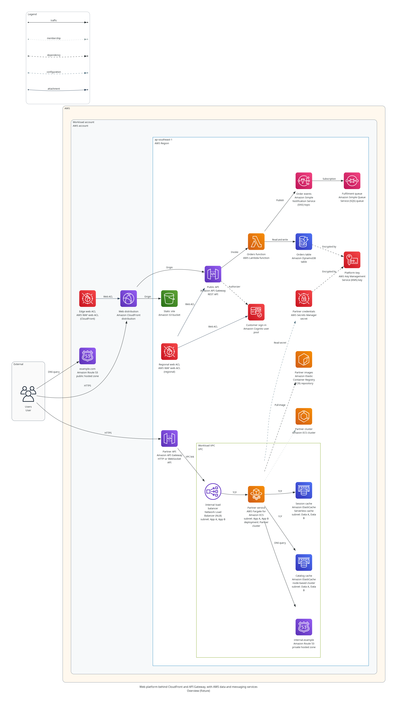

# S13 — AWS edge, API, data, messaging and security types

Date: 2026-11-05 | Branch: `codex/aws-next-types`, from `3b692c1` on `codex/aws-ecs-fargate-lambda-waf`, because that branch was not merged then | Decision: D-037

**Result: strict validation and rendering now accept 16 new AWS types: 15 for the owner's choice of 12 services, and a CloudFront web ACL, because S12's one WAF type becomes two now that CloudFront is here. Each has one taxonomy ID, a placement rule from AWS's own pages and AWS's own icon. The owner had it merged into `main` on 2026-11-05, the tag `v0.1.0-alpha.1` does not move, and no live session has used it yet.**

## Why

[S12](S12-aws-ecs-lambda-waf.md#limits) left requests that name CloudFront or API Gateway ending as lenient drafts, and listed 15 AWS gaps as the owner's call. This is selected P1 coverage, so the inventory in requirements section 6 does not change.

## What the owner chose

Each gap was confirmed before editing, with `cloud-diagrams catalog --provider aws --query <term>` at `3b692c1`. All returned no records, except that `ecr` found only the Kubernetes Secret. The owner then chose from S12's list:

| Added | Left out |
|---|---|
| CloudFront, API Gateway, Route 53, Network Load Balancer, DynamoDB, ElastiCache, SQS, SNS, Cognito, Secrets Manager, KMS, ECR | EventBridge, Step Functions, App Runner |

## The types

| Type | Native ID | Taxonomy | Icon class in `diagrams` 0.25.1 | Location | Network |
|---|---|---|---|---|---|
| `aws.network.cloudfront` | `AWS::CloudFront::Distribution` | `edge.delivery` | `aws.network.CloudFront` | Global | None |
| `aws.security.waf_cloudfront` | `AWS::WAFv2::WebACL` | `security.control` | `aws.security.WAF` | Global | None |
| `aws.integration.api_gateway_rest` | `AWS::ApiGateway::RestApi` | `integration.messaging` | `aws.network.APIGateway` | Regional | None |
| `aws.integration.api_gateway_v2` | `AWS::ApiGatewayV2::Api` | `integration.messaging` | `aws.network.APIGateway` | Regional | None |
| `aws.network.route53_public_zone` | `AWS::Route53::HostedZone` | `network.routing` | `aws.network.Route53` | Global | None |
| `aws.network.route53_private_zone` | `AWS::Route53::HostedZone` | `network.routing` | `aws.network.Route53` | Global | Any number of VPCs, no subnets |
| `aws.network.network_load_balancer` | `AWS::ElasticLoadBalancingV2::LoadBalancer` | `network.load_balancing` | `aws.network.ElbNetworkLoadBalancer` | Regional | One VPC, one subnet for each zone |
| `aws.database.dynamodb` | `AWS::DynamoDB::Table` | `data.nosql_cache` | `aws.database.Dynamodb` | Regional | None |
| `aws.database.elasticache` | `AWS::ElastiCache::ReplicationGroup` | `data.nosql_cache` | `aws.database.Elasticache` | Region or zone | One VPC |
| `aws.database.elasticache_serverless` | `AWS::ElastiCache::ServerlessCache` | `data.nosql_cache` | `aws.database.Elasticache` | Regional | Optional: one VPC |
| `aws.integration.sqs` | `AWS::SQS::Queue` | `integration.messaging` | `aws.integration.SimpleQueueServiceSqs` | Regional | None |
| `aws.integration.sns` | `AWS::SNS::Topic` | `integration.messaging` | `aws.integration.SimpleNotificationServiceSns` | Regional | None |
| `aws.identity.cognito_user_pool` | `AWS::Cognito::UserPool` | `identity.access` | `aws.security.Cognito` | Regional | None |
| `aws.security.secrets_manager` | `AWS::SecretsManager::Secret` | `security.secrets_keys` | `aws.security.SecretsManager` | Regional | None |
| `aws.security.kms` | `AWS::KMS::Key` | `security.secrets_keys` | `aws.security.KeyManagementService` | Regional | None |
| `aws.containers.ecr` | `AWS::ECR::Repository` | `compute.containers` | `aws.compute.EC2ContainerRegistry` | Regional | None |

**The owner's 12 services became 15 types, and S12's WAF type became two, which makes 16.** The owner did not choose these splits. They are this session's call, because S06 gives a variant its own type where a rule differs:

- API Gateway: AWS WAF applies to a REST API and not to an HTTP API.
- Route 53: a public hosted zone omits VPCs, and a private one associates with them.
- ElastiCache: a node-based cluster can sit in one zone, and a serverless cache offers none to choose.
- WAF: a CloudFront web ACL differs from a regional one in location and in what it protects.

Variants of one service draw its one icon, as the two NAT gateway types do. A test allows that for these four pairs and no others.

`aws.security.waf` keeps its ID and stays regional, so a model that protects an ALB stays valid. Its display name becomes "AWS WAF web ACL (regional)", which is what a picture now draws under its icon.

**The catalog's own format changed in two additive ways, so the schema stays at 1.0.0:** seven capabilities (`cache`, `container_registry`, `content_delivery`, `dns`, `key_management`, `messaging`, `secret_management`), because none described these services, and one placement field, `one_subnet_per_zone`. **No rule code is new**, because existing codes cover every rule here. Their remedies now name these types. Two taxonomy meanings widen, because the frozen list has no closer ID: `network.routing` gains DNS routing for a hosted zone, and `compute.containers` gains registries for a repository. Their IDs do not change.

## What each rule rests on

Each page was fetched on 2026-11-05 and is recorded in `S06-source-checks.json`, with a short pattern that matched its text and its own `checked` date. That record holds 45 new pages and updates the four it already held. The table below restates AWS's rules rather than quoting them.

| Rule | What AWS states | Source |
|---|---|---|
| A distribution, a hosted zone and WAF for CloudFront are global | Listed among global services, each with its control plane in us-east-1 | [Global services](https://docs.aws.amazon.com/whitepapers/latest/aws-fault-isolation-boundaries/global-services.html) |
| A CloudFront web ACL takes no region | WAF is available globally for CloudFront, and the "Global (CloudFront)" choice is the same as us-east-1 | [Resources WAF protects](https://docs.aws.amazon.com/waf/latest/developerguide/how-aws-waf-works-resources.html) |
| A web ACL protects only listed types | The list names a distribution, a REST API, an ALB and a Cognito user pool, among types not in this catalog, and neither an HTTP API nor an NLB | [What is AWS WAF](https://docs.aws.amazon.com/waf/latest/developerguide/what-is-aws-waf.html) |
| A regional web ACL shares its resource's Region, and a global one goes with a distribution | Stated as the two kinds of association | [Associating](https://docs.aws.amazon.com/waf/latest/developerguide/web-acl-associating-aws-resource.html) |
| One web ACL type cannot serve the other's resource | A web ACL on a distribution cannot also go on another resource type | [Associating](https://docs.aws.amazon.com/waf/latest/developerguide/web-acl-associating-aws-resource.html) |
| One web ACL for each resource, and one may serve several distributions | Stated as restrictions, and a distribution's configuration names one | [Associating](https://docs.aws.amazon.com/waf/latest/developerguide/web-acl-associating-aws-resource.html), [DistributionConfig](https://docs.aws.amazon.com/AWSCloudFormation/latest/TemplateReference/aws-properties-cloudfront-distribution-distributionconfig.html) |
| A REST API takes a regional web ACL | API Gateway's WAF page requires a web ACL for a regional application. It makes no exception for an edge-optimized endpoint, and reading that as all endpoint types is this record's inference | [API Gateway and WAF](https://docs.aws.amazon.com/apigateway/latest/developerguide/apigateway-control-access-aws-waf.html) |
| An HTTP API takes no web ACL | Its feature table marks AWS WAF as REST only | [REST or HTTP](https://docs.aws.amazon.com/apigateway/latest/developerguide/http-api-vs-rest.html) |
| A public hosted zone takes no network | CloudFormation says to omit VPCs for one | [`AWS::Route53::HostedZone`](https://docs.aws.amazon.com/AWSCloudFormation/latest/TemplateReference/aws-resource-route53-hostedzone.html) |
| A private hosted zone may serve VPCs in several Regions | AWS's own example associates VPCs in two Regions, and more can be added by Region and ID | [`AWS::Route53::HostedZone`](https://docs.aws.amazon.com/AWSCloudFormation/latest/TemplateReference/aws-resource-route53-hostedzone.html), [Associating more VPCs](https://docs.aws.amazon.com/Route53/latest/DeveloperGuide/hosted-zone-private-associate-vpcs.html) |
| An NLB needs one or more zones and one subnet for each | Stated for subnets and subnet mappings | [`AWS::ElasticLoadBalancingV2::LoadBalancer`](https://docs.aws.amazon.com/AWSCloudFormation/latest/TemplateReference/aws-resource-elasticloadbalancingv2-loadbalancer.html), [CreateLoadBalancer](https://docs.aws.amazon.com/elasticloadbalancing/latest/APIReference/API_CreateLoadBalancer.html) |
| An NLB's subnets share one VPC | Its setup selects the load balancer's VPC, with subnets in each chosen zone | [Create an NLB](https://docs.aws.amazon.com/elasticloadbalancing/latest/network/create-network-load-balancer.html) |
| A node-based cache's subnets share one VPC | A cache subnet group is defined for a VPC, and the console creates it from one VPC ID | [Subnet groups](https://docs.aws.amazon.com/AmazonElastiCache/latest/dg/SubnetGroups.Creating.html), [VPCs](https://docs.aws.amazon.com/AmazonElastiCache/latest/dg/VPCs.EC.html) |
| A node-based cache may state a zone | All of a cluster's nodes can be placed in a preferred zone, or across zones | [`AWS::ElastiCache::CacheCluster`](https://docs.aws.amazon.com/AWSCloudFormation/latest/TemplateReference/aws-resource-elasticache-cachecluster.html) |
| A serverless cache's subnets share one VPC | Stated for `SubnetIds` | [CreateServerlessCache](https://docs.aws.amazon.com/AmazonElastiCache/latest/APIReference/API_CreateServerlessCache.html) |
| A serverless cache states no zone, and may have no VPC | It stores data across three zones, and can have a public endpoint | [Deployment options](https://docs.aws.amazon.com/AmazonElastiCache/latest/dg/WhatIs.deployment.html), [Components](https://docs.aws.amazon.com/AmazonElastiCache/latest/dg/WhatIs.corecomponents.html) |
| A table, a queue, a user pool and a key are regional | A table's or queue's name is unique per account and Region, a user pool is created in one Region, and a multi-Region key is still not global | [Tables](https://docs.aws.amazon.com/amazondynamodb/latest/developerguide/WorkingWithTables.Basics.html), [Queues](https://docs.aws.amazon.com/AWSSimpleQueueService/latest/SQSDeveloperGuide/sqs-queue-message-identifiers.html), [User pools](https://docs.aws.amazon.com/cognito/latest/developerguide/security-cognito-regional-data-considerations.html), [Keys](https://docs.aws.amazon.com/kms/latest/developerguide/multi-region-keys-overview.html) |
| A topic, a secret and a repository are regional | A topic delivers across Regions, a replica secret's ARN differs by Region, and a registry's URL names one | [Topics](https://docs.aws.amazon.com/sns/latest/dg/sns-cross-region-delivery.html), [Secrets](https://docs.aws.amazon.com/secretsmanager/latest/userguide/replicate-secrets.html), [Registries](https://docs.aws.amazon.com/AmazonECR/latest/userguide/Registries.html) |
| None of these takes a network | Their CloudFormation types name no VPC or subnet property, and S06 reads a network form from the real configuration | The `AWS::*` pages in each record's `sources` |

The SNS row is the weakest: the page implies that a topic has one Region and does not state it. The same holds for the secret and the repository, whose Region is read from an ARN and a URL.

## Calls that could have gone another way

**A CloudFront web ACL refuses a region, although AWS has it created in us-east-1.** AWS gives two descriptions of one thing: it is global, and it must be made in us-east-1. A region's name is a free label here, so a rule could not tell us-east-1 from any other. Allowing a region would accept every wrong one. So this follows IAM, whose control plane is also in us-east-1, and the remedy says why. A model that names us-east-1 fails and is corrected in one step. This is the rule here most open to reversal, by changing `location` on that record.

**Cognito is a web ACL target, which the brief did not name.** The brief named CloudFront and API Gateway. AWS's list also has the Cognito user pool, and the owner added Cognito, so leaving it out would refuse a valid model.

**API Gateway holds no network, even for a private REST API.** Pictures often draw one inside a VPC. A private API is reached through an interface VPC endpoint, an HTTP API reaches a private resource through a VPC link, and neither API type has a VPC or subnet property. Endpoints and VPC links are not catalog types, so a model shows them as a labeled relationship, and the picture does. S12 made the same call for an ECS cluster and for the same reason.

**One HTTP or WebSocket type, not two.** They share a native ID and every rule here, so S06 gives no reason to split them.

**One native ID for a node-based cache.** A record holds one, so this names `AWS::ElastiCache::ReplicationGroup`, and a Memcached cluster is really `AWS::ElastiCache::CacheCluster`. Nothing reads this field to make a decision, and the rule is the same for both.

**A node-based cache is `zonal`, and that does not make a zone required.** It only allows one, as for RDS. A cache across zones names a region, and a stated zone that disagrees with a listed subnet fails. AWS allows a one-zone cluster on a subnet group that spans more zones, so that model must list only the subnets its nodes use. `subnet_refs` here means where the nodes attach and not the whole group, which is how S06 reads an RDS subnet group. A model is corrected in one step, and a rule on the whole group would need a field the model does not have.

**The one-subnet rule applies to the NLB alone, although AWS states it for the ALB too.** Adding it to the ALB would tighten an existing type in a change about new ones, so that waits as a separate decision. It is listed below.

**A private hosted zone is drawn inside its VPC's box,** because the view groups by network. That shows an association and not a location, and a zone on two VPCs nests in one of them while `view.json` keeps both. A test renders that case.

## Deliberately not enforced

| Not enforced | Why |
|---|---|
| One subnet for each zone on an ALB | AWS states it. Adding it tightens an existing type, so it needs its own decision |
| A security group on a private hosted zone | A hosted zone has none, but the existing check reads only network form `none`. An internet gateway has the same gap, and a rule needs a new field |
| At least one VPC on a private hosted zone, or a subnet list on an NLB | AWS requires them, but a rule fires only on what a model declares |
| A web ACL using account takeover prevention on a user pool | AWS forbids it, and the model does not describe a web ACL's rules |
| An internet-facing NLB in a public subnet | Nothing in a model states the scheme, and the record has no rule for it |
| The number of subnets in a cache subnet group | AWS sets this as an adjustable quota rather than a rule |
| A Cognito identity pool, a public ECR repository or a DynamoDB global table as types | Not chosen. A global table is drawn as one table per region with a `replication` edge, as the model guide says |

## Icons and rights

All 12 icon classes are in the `aws-architecture-icons` pack, which the rights manifest already lists as approved for architecture diagrams. They arrive through the pinned `diagrams` 0.25.1 wheel, and `native_icons.json` locks each file's digest. Nothing is copied into the package, nothing needed a stand-in, and no pack changed. The icons were looked at directly in the picture. Eleven are AWS's service icons and `ElbNetworkLoadBalancer` is AWS's NLB resource icon, as the ALB's is. Upstream copies may be older than AWS's current set, which FR-048 already discloses.

The picture holds AWS and generic icons only, and a test requires its manifest to say `private_use_only: false`. Huawei's limit under D-018 and O-002 is unchanged. The package and plugins still hold Huawei icons, so they stay private.

## Effects outside the catalog

| Area | Change |
|---|---|
| Catalog version | `2026.11.1` to `2026.11.2` in every catalog file |
| Existing models | Valid models stay valid. No existing rule tightened. A model attaching a web ACL to an unknown CloudFront type was a draft in S12. It stays a draft until it uses the new type, and then the web ACL must be `aws.security.waf_cloudfront` |
| Catalog search | `load balancer` with `--provider aws` now finds two types. `nlb`, `sqs`, `sns`, `kms`, `ecr` and the long names find theirs, because the display names spell both. `ecr` also finds Secrets Manager and the Kubernetes Secret, because the search matches substrings. `alb` still finds nothing, and aliases stay P1 under FR-054 |
| Model guide | States how to place these types |
| Work skill | Its example of a missing service moves from Amazon CloudFront to Amazon EventBridge. It had gone stale once already, so a test now checks that the example is really missing |
| Reference baselines | Unchanged. `update_visual_baselines.py` was not run, and no renderer code or reference model changed |
| S12's picture | Drawn at `2026.11.1`, so its web ACL label predates the new display name. It is left as that record's evidence |
| Claude plugin | Versioned by commit, so a merge reaches it with no bump |
| Work plugin | Becomes `0.1.0-alpha.1+44aa26b1a6e3` when built from this branch. It holds the 15 Huawei icon pairs, so it stays private under D-018 and O-002 |

**The core package takes no new version here,** for S12's reason: `uv.lock` and both plugins' private runtime would otherwise change, and the catalog version is what results report for this change.

## Validation

`uv run --frozen python scripts/quality_gate.py` passes all 17 lanes with 1935 tests, none skipped, on a clean checkout of `cec1d21`. Actual Quality gate [run 42040895164](https://github.com/Rabcat-dome/mingrammer-diagram/actions/runs/42040895164) passes at that commit on the project's runner. The commit after it records only this. An earlier [run 42040056459](https://github.com/Rabcat-dome/mingrammer-diagram/actions/runs/42040056459) at `b54375f` failed `release-audit` alone, as expected, because the proof was replaced after it.

| Lane | Tests, none skipped | What it adds here |
|---|---:|---|
| `provider-semantics` | 721 | The 54 new negative cases on the new fixture, and positive and boundary tests. A new test requires each of these, and the 36 on S12's fixture, to fail for one reason alone, which S12's review noted nothing guarded |
| `catalog-license` | 135 | Each new type's icon from the listed pack, with sharing allowed only between the four variant pairs, and no new type in the P0 inventory. The names a request uses find their types, and the skill's example of a missing service really is missing |
| `render-smoke` | 370 | One picture with all 16 new types and the regional web ACL, marked strict, not draft and not private-use. A global type sits outside the Region's box and a regional one inside it. A private hosted zone on VPCs in two regions renders, and keeps both |
| `visual-regression` | 65 | All 26 baselines unchanged, with no baseline file edited and `update_visual_baselines.py` not run |
| Other test lanes | 644 | `schema-core` 97, `claude-plugin` 60, `package-contract` 169, `release-audit` 67 and `render-security` 251 |

**Reproduction.** `scripts/reproduce_core.py` rebuilt the core from a new clone of the pushed `b54375f`, in a runtime that shares nothing with this checkout. All 26 reference views match their baselines by both routes, and the wheel's SHA-256 `05336718...de85` matches the local build. It reports core `0.5.0a2` and catalog `2026.11.2`. It ran on this one Mac, so it proves a clean runtime and not a second machine.

**Sabotage.** Each of these was made in the real repository at `1485f27`, failed its tests and was restored, with the `src` digest identical afterwards. Later commits changed one taxonomy meaning in `src`, and the negative cases these name still pass:

| Change | Result |
|---|---|
| An NLB may list two subnets in one zone | `aws-nlb-two-subnets-one-zone` failed |
| The one-subnet check is switched off | `aws-nlb-two-subnets-one-zone` failed |
| An NLB may use two VPCs | `aws-nlb-two-vpcs` failed |
| A regional web ACL may protect a distribution | `aws-regional-acl-on-distribution` failed |
| A CloudFront web ACL may protect a REST API | `aws-cloudfront-acl-on-rest-api` failed |
| A web ACL may protect an HTTP API | `aws-regional-acl-on-http-api` failed |
| A web ACL may protect an NLB | `aws-regional-acl-on-nlb` failed |
| A CloudFront web ACL may state a region | `aws-cloudfront-acl-in-region` failed |
| A distribution may state a region | `aws-cloudfront-in-region` failed |
| A public hosted zone may attach to a VPC | `aws-public-zone-with-vpc` failed |
| A private hosted zone may list subnets | `aws-private-zone-subnets` failed |
| A serverless cache may state a zone | `aws-elasticache-serverless-in-zone` failed |
| A cache may use two VPCs | `aws-elasticache-two-vpcs` failed |
| A REST API may attach to a VPC | `aws-rest-api-in-vpc` failed |
| DynamoDB may attach to a subnet | `aws-dynamodb-in-vpc` failed |
| KMS may state a zone | `aws-kms-in-zone` failed |
| CloudFront borrows the S3 icon | The catalog check failed |
| SQS names an icon the lock does not hold | The catalog check failed |
| Route 53 gets a second taxonomy | The positive fixture failed |

## Limits

- **No live session has used these types.** This does not yet show that an ordinary request now ends strict.
- **Neither plugin was reinstalled**, and no Work session ran this version. The owner's installed copies are unchanged.
- **S12 reached `main` first,** on the owner's answer, so merging this added only S13.
- **FR-048's comparison was not repeated.** The picture was looked at, and it was not compared with an AWS reference diagram. It has no reviewed baseline. Two arrows touch a label, on the ECS cluster and the ECR repository, because Graphviz routes them through that rank.
- **The owner accepted the picture on 2026-11-05,** translated from Thai: "the picture is fine". That covers [this picture](S13-aws-next-types.png) only, SHA-256 `19d073cfa9770ef2a4ab08f5b3e7156e916f96d4495e21ec6887d3ab32ed67b0`. It accepts neither a merge nor a comparison with an AWS reference.
- **Sources were checked once.** Nothing re-fetches them, as S06 says of its own pages.
- **AWS gaps that remain.** EventBridge, Step Functions and App Runner, which the owner left out, and anything S12's list did not name. Which to add is the owner's call.

## Model and review

Implementation used **Claude Opus 5.5 (`claude-opus-5-5`)**, the model of the session that ran this, rather than the planned Sol, with no setting changed. **Claude Fable 5.1 approved it** under D-021, with three P3 findings and then one more on the follow-up, and it is [recorded separately](S13-fable-review.md) with what is open.

## Next steps

1. Done: the owner said to merge on 2026-11-05, which confirms D-037.
2. After a merge, rebuild and reinstall the Work plugin, run `scripts/work_host_check.py` as the handoff says, and repeat one of M7's AWS requests in a live session.
