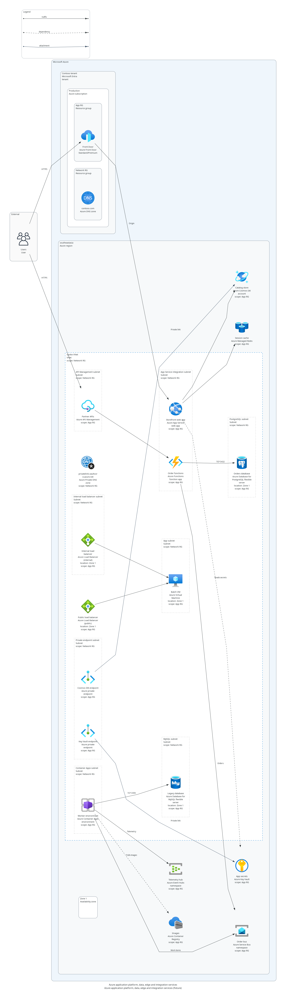
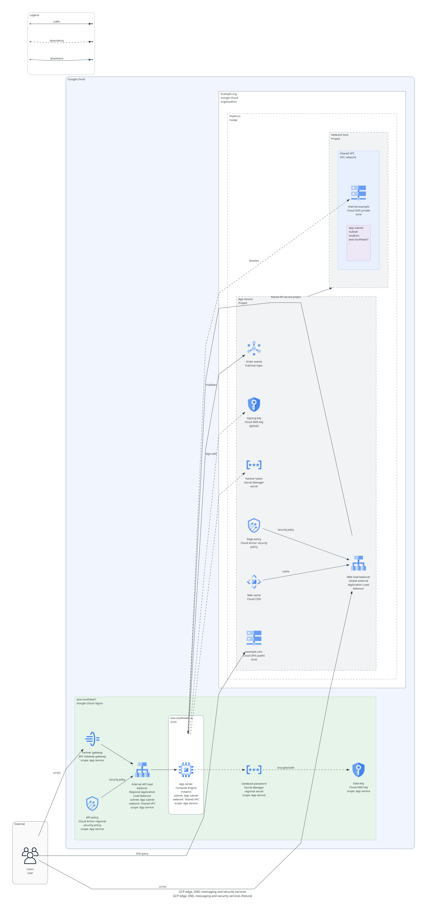
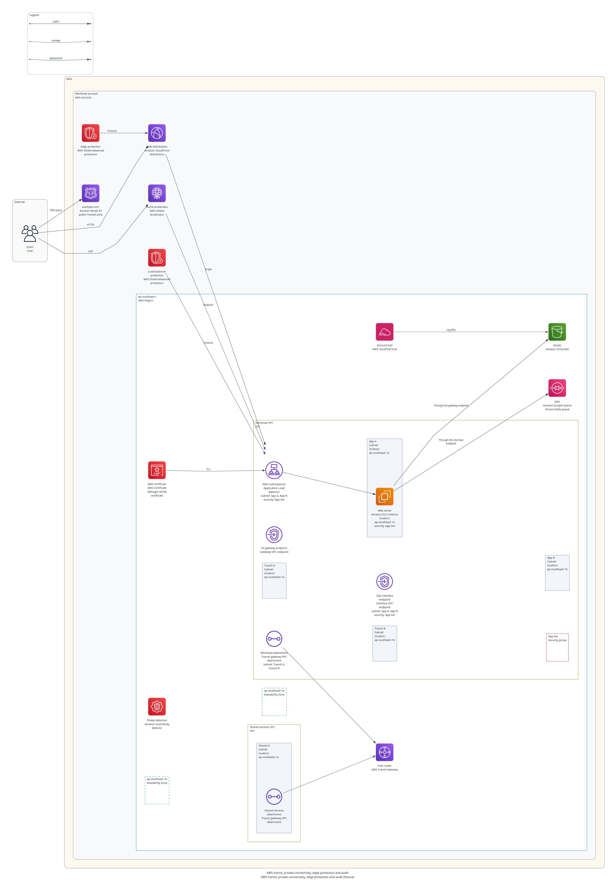
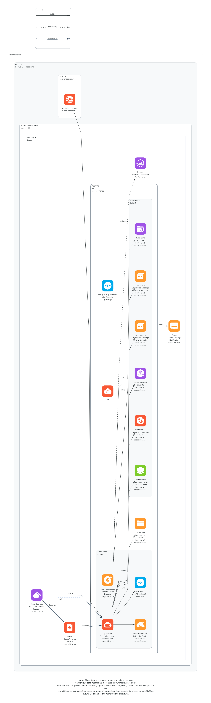

# S16 — Azure, GCP, AWS and Huawei Cloud coverage

Date: 2026-11-08 | Branch: `codex/catalog-coverage-s16`, from `main` at `e56a188` | Decision: D-053

**Result: strict validation and rendering accept 54 new types: 18 for Azure, 11 for GCP, 9 for AWS and 16 for Huawei Cloud, from the owner's choice of service groups. Each has one taxonomy ID, a placement rule from its provider's own pages and its provider's own icon. The catalog becomes `2026.11.3`. Nothing is merged or installed, and no live session has used these types.**

## Why

After S15, no milestone was scheduled. The owner asked, translated from Thai, which activities remained, and chose "More catalog coverage" from this session's list. Azure had 15 resource types and GCP 17, against AWS's 37. This is selected P1 coverage under FR-054's later work, so the inventory in requirements section 6 does not change.

## What the owner chose

This session offered four groups of services per provider, each confirmed to have an icon in the pinned `diagrams` 0.25.1 or the pinned Huawei library, and the owner ticked these:

| Provider | Groups chosen | Groups left out |
|---|---|---|
| Azure | App hosting, Data, Edge and network, Integration and security | None |
| GCP | Edge and network, Integration and security | Serverless, Data |
| AWS | Network, Security and audit | EventBridge, Step Functions and App Runner again, Data and storage |
| Huawei Cloud | Data, Messaging, Containers and storage, Network | None |

## The types

Four research agents, one per provider, read the providers' pages and returned each fact with a phrase copied from the page. This session then chose the types below, and every cited page was fetched again and its phrases matched, as [below](#what-each-rule-rests-on) says.

### Azure

| Type | Native ID | Location | Network | Icon in `diagrams` 0.25.1 |
|---|---|---|---|---|
| `azure.compute.app_service` | `Microsoft.Web/sites` | Regional | One delegated subnet | `azure.appservices.AppServices` |
| `azure.compute.function_app` | `Microsoft.Web/sites` | Regional | One delegated subnet | `azure.compute.FunctionApps` |
| `azure.containers.container_apps_environment` | `Microsoft.App/managedEnvironments` | Regional | One delegated subnet | `azure.other.ContainerAppsEnvironments` |
| `azure.containers.container_registry` | `Microsoft.ContainerRegistry/registries` | Regional | None | `azure.containers.ContainerRegistries` |
| `azure.database.cosmos_db` | `Microsoft.DocumentDB/databaseAccounts` | Regional | None | `azure.databases.AzureCosmosDb` |
| `azure.database.postgresql_flexible_server` | `Microsoft.DBforPostgreSQL/flexibleServers` | Region or zone | One delegated subnet | `azure.databases.AzureDatabasePostgresqlServer` |
| `azure.database.mysql_flexible_server` | `Microsoft.DBforMySQL/flexibleServers` | Region or zone | One delegated subnet | `azure.databases.AzureDatabaseMysqlServer` |
| `azure.database.managed_redis` | `Microsoft.Cache/redisEnterprise` | Regional | None | `azure.databases.CacheRedis` |
| `azure.network.front_door` | `Microsoft.Cdn/profiles` | Global | None | `azure.networking.FrontDoorAndCDNProfiles` |
| `azure.network.load_balancer_public` | `Microsoft.Network/loadBalancers` | Region or zone | One VNet, no subnet | `azure.networking.LoadBalancers` |
| `azure.network.load_balancer_internal` | `Microsoft.Network/loadBalancers` | Region or zone | Subnets of one VNet | `azure.networking.LoadBalancers` |
| `azure.network.dns_zone` | `Microsoft.Network/dnsZones` | Global | None | `azure.networking.DNSZones` |
| `azure.network.private_dns_zone` | `Microsoft.Network/privateDnsZones` | Global | VNets, each once | `azure.network.DNSPrivateZones` |
| `azure.network.private_endpoint` | `Microsoft.Network/privateEndpoints` | Regional | One subnet | `azure.other.PrivateEndpoints` |
| `azure.integration.service_bus` | `Microsoft.ServiceBus/namespaces` | Regional | None | `azure.integration.AzureServiceBus` |
| `azure.integration.event_hubs` | `Microsoft.EventHub/namespaces` | Regional | None | `azure.analytics.EventHubs` |
| `azure.integration.api_management` | `Microsoft.ApiManagement/service` | Region or zone | One subnet | `azure.integration.APIManagementServices` |
| `azure.security.key_vault` | `Microsoft.KeyVault/vaults` | Regional | None | `azure.security.KeyVaults` |

A private endpoint attaches to the App Service, function app, Container Apps environment, registry, Cosmos DB, both flexible servers, Managed Redis, Service Bus, Event Hubs, API Management, Key Vault, SQL Database, Blob Storage or Application Gateway it reaches, in any region.

### GCP

| Type | Native ID | Location | Network | Icon |
|---|---|---|---|---|
| `gcp.network.cloud_dns_public_zone` | `dns.googleapis.com/ManagedZone` | Global | None | `gcp.network.DNS` |
| `gcp.network.cloud_dns_private_zone` | `dns.googleapis.com/ManagedZone` | Global | VPC networks, no subnet | `gcp.network.DNS` |
| `gcp.security.cloud_armor_policy` | `compute.googleapis.com/SecurityPolicy` | Global | None | `gcp.network.Armor` |
| `gcp.security.cloud_armor_regional_policy` | `compute.googleapis.com/SecurityPolicy` | Regional | None | `gcp.network.Armor` |
| `gcp.network.cloud_cdn` | None | Global | None | `gcp.network.CDN` |
| `gcp.integration.pubsub_topic` | `pubsub.googleapis.com/Topic` | Global | None | `gcp.analytics.PubSub` |
| `gcp.security.secret_manager_secret` | `secretmanager.googleapis.com/Secret` | Global | None | `gcp.security.SecretManager` |
| `gcp.security.secret_manager_regional_secret` | `secretmanager.googleapis.com/Secret` | Regional | None | `gcp.security.SecretManager` |
| `gcp.security.kms_key` | `cloudkms.googleapis.com/CryptoKey` | Regional | None | `gcp.security.KeyManagementService` |
| `gcp.security.kms_key_global` | `cloudkms.googleapis.com/CryptoKey` | Global | None | `gcp.security.KeyManagementService` |
| `gcp.integration.api_gateway` | `apigateway.googleapis.com/Gateway` | Regional | None | `gcp.api.APIGateway` |

The global Cloud Armor policy and Cloud CDN attach to the global external Application Load Balancer. The regional policy attaches to a regional Application Load Balancer, a passthrough Network Load Balancer or a Compute Engine instance, in its own region.

### AWS

| Type | Native ID | Location | Network | Icon |
|---|---|---|---|---|
| `aws.network.transit_gateway` | `AWS::EC2::TransitGateway` | Regional | None | `aws.network.TransitGateway` |
| `aws.network.transit_gateway_vpc_attachment` | `AWS::EC2::TransitGatewayVpcAttachment` | Regional | Subnets of one VPC, one for each zone | `aws.network.TransitGatewayAttachment` |
| `aws.network.vpc_gateway_endpoint` | `AWS::EC2::VPCEndpoint` | Regional | One VPC, no subnet | `aws.network.Endpoint` |
| `aws.network.vpc_interface_endpoint` | `AWS::EC2::VPCEndpoint` | Regional | Subnets of one VPC, one for each zone | `aws.network.Endpoint` |
| `aws.network.global_accelerator` | `AWS::GlobalAccelerator::Accelerator` | Global | None | `aws.network.GlobalAccelerator` |
| `aws.security.shield_protection` | `AWS::Shield::Protection` | Any | None | `aws.security.Shield` |
| `aws.security.guardduty` | `AWS::GuardDuty::Detector` | Regional | None | `aws.security.Guardduty` |
| `aws.observability.cloudtrail` | `AWS::CloudTrail::Trail` | Regional | None | `aws.management.Cloudtrail` |
| `aws.security.acm_certificate` | `AWS::CertificateManager::Certificate` | Regional | None | `aws.security.CertificateManager` |

Global Accelerator attaches to an ALB, an NLB or an EC2 instance. A Shield Advanced protection attaches to a CloudFront distribution, a public hosted zone, an accelerator, an ALB, an NLB or an EC2 instance. An ACM certificate attaches to an ALB, an NLB, a CloudFront distribution, either API Gateway type or a Cognito user pool.

### Huawei Cloud

Each draws its icon from the pinned color library under D-018, so each is `private_use_only`.

| Type | Native ID | Location | Network | IAM | Enterprise project | Library title |
|---|---|---|---|---|---|---|
| `huawei.database.dcs_redis` | DCS | Region or zone | Subnets | Project | Yes | Distributed Cache Service (DCS) for Redis |
| `huawei.database.dds` | DDS | Region or zone | Subnets | Project | Yes | Document Database Service (DDS) |
| `huawei.database.gaussdb` | GaussDB | Region or zone | Subnets | Project | Yes | GaussDB |
| `huawei.integration.dms_kafka` | DMS | Region or zone | Subnets | Project | Yes | Distributed Message Service (DMS) |
| `huawei.integration.dms_rabbitmq` | DMS | Region or zone | Subnets | Project | Yes | Distributed Message Service (DMS) |
| `huawei.integration.smn` | SMN | Regional | None | Project | Yes | Simple Message Notification (SMN) |
| `huawei.containers.swr` | SWR | Regional | None | Project | No | SoftWare Repository for Container (SWR) |
| `huawei.containers.cci` | CCI | Regional | Subnets of one VPC | Project | Yes | Cloud Container Instance (CCI) |
| `huawei.storage.sfs` | SFS | Region or zone | VPCs, no subnet | Project | Yes | Scalable File Service (SFS) |
| `huawei.storage.sfs_turbo` | SFS Turbo | Region or zone | Subnets | Project | Yes | Scalable File Service (SFS) Turbo |
| `huawei.storage.evs` | EVS | Region or zone | None | Project | Yes | Elastic Volume Service (EVS) |
| `huawei.storage.cbr_vault` | CBR | Regional | None | Project | Yes | Cloud Backup and Recovery (CBR) |
| `huawei.network.enterprise_router` | ER | Region or zone | Subnets | Project | Yes | Enterprise Router (ER) |
| `huawei.network.vpc_endpoint` | VPCEP | Regional | Subnets | Project | No | VPC Endpoint (VPCEP) |
| `huawei.network.vpc_endpoint_gateway` | VPCEP | Regional | VPCs, no subnet | Project | No | VPC Endpoint (VPCEP) |
| `huawei.network.global_accelerator` | GA | Global | None | Global | Yes | Global Accelerator (GA) |

An EVS disk attaches to an ECS in its region. A CBR vault attaches to the ECS, EVS disks and SFS Turbo file systems it backs up.

## Splits, trims and calls that could have gone another way

These are this session's calls, as S13's splits were. Correct them here if the owner prefers otherwise.

- **Variants with their own type**, because a placement fact differs, as S06 asks: Azure's public and internal load balancers, GCP's public and private DNS zones, global and regional Cloud Armor policies, secrets and KMS keys, AWS's gateway and interface VPC endpoints, and Huawei's SFS and SFS Turbo and interface and gateway VPC endpoints. Variants of one service draw its one icon, and a test allows that for these pairs and no others.
- **A type the owner did not name:** the AWS transit gateway VPC attachment. A transit gateway has no VPC property, and each VPC joins it through an attachment that takes one subnet per zone. A rule on the gateway itself would refuse two VPCs' subnets in one zone, which AWS allows.
- **Azure Managed Redis in place of Azure Cache for Redis**, which Microsoft retires from 2027 to 2028 and tells users to move off. Its Premium tier's VNet injection is left out.
- **The Container Apps environment, not the container app**, because the environment holds the subnet and a container app holds no network property.
- **One API Management type.** Microsoft's classic and v2 tiers differ: classic Premium may state a zone and share its subnet, and v2 is regional and needs a delegated subnet of its own. One type that allows a zone and no dedicated subnet refuses no valid model of either, and misses a v2 subnet shared with another service.
- **Cloud CDN as a node with no native ID.** In Google's API it is a setting on a backend service or bucket of the global external Application Load Balancer. People draw it as its own node, and the record keeps a model from attaching it to another load balancer.
- **One Shield protection type with location `any`.** AWS gives no Region for a protection. Its Config history splits global and regional resources, and its API is served from `us-east-1`, which a region name cannot express. A split on that basis would rest on inference.
- **No region rule for an ACM certificate.** It must share the Region of an ALB, an NLB or an HTTP API, but sit in `us-east-1` for CloudFront and Cognito, and a region's name is a free label here.
- **Left out:** AWS's Gateway Load Balancer endpoint, because the catalog has no Gateway Load Balancer; Huawei's VPC endpoint service, which is the provider's side; SWR Enterprise Edition, in open beta; and TaurusDB, the renamed GaussDB(for MySQL), which the owner did not name.
- **Both DMS editions draw the DMS entry.** The library also holds entries titled "Kafka" and "RabbitMQ", but the catalog's check accepts an icon only where its title names the service, and these name the engine. Mapping them would break the rule S06 set against guessing.
- **Huawei enterprise flags** follow the IAM page's "Enterprise Project" column, as the existing records do. GaussDB, SFS Turbo, Enterprise Router and Global Accelerator have no row there, so theirs come from the Enterprise Project Management Service's list of supported services.

## Rules that changed

- **An attachment is read either way.** An `attachment` edge is owned by the end whose record lists the other end's type, whichever way it is drawn, and refused only when neither does and one lists targets. Before, the second direction was checked only when the first listed nothing, which would refuse a CBR vault on an EVS disk, because EVS lists only ECS.
- **The one-web-ACL rule stays AWS WAF's.** It now counts web ACLs alone, so an ALB with a web ACL, a certificate and a Shield protection is not three web ACLs. No other type's pages state a one-owner rule.
- **A region rule for any type that asks for it.** A new placement field, `same_region_as_targets`, holds an owner and its targets to one region where each declares one. Both WAF types set it and keep their code. A regional Cloud Armor policy and an EVS disk set it and report the new `PLACEMENT_ATTACHMENT_REGION_MISMATCH`.
- **A delegated subnet holds one service.** Before, two different dedicated types could share a subnet. Now types share one only where they share a native resource type, as a web app and a function app share `Microsoft.Web/sites` and its delegation.
- The remedies of `PLACEMENT_ATTACHMENT_TARGET_INVALID` and `PLACEMENT_DEDICATED_SUBNET_CONFLICT` now speak of every type, and their sources name the new pages.

The catalog schema gains the one field, so its schema stays at 1.0.0. No capability or taxonomy ID is new.

## What each rule rests on

Each cited page was fetched on 2026-11-08, its HTML reduced to text, the text hashed and each phrase matched, and all of this is recorded in `S06-source-checks.json`: 126 new pages and 221 phrases, every one matched. The research agents matched each phrase too, before this session fetched the pages again.

| Provider | Pages | Where the facts come from |
|---|---:|---|
| Azure | 58 | Each service's networking and reliability pages, the ARM template reference for each type, and the private endpoint, Private DNS and retirement pages |
| GCP | 19 | Cloud DNS, Cloud Armor, Cloud CDN, Pub/Sub, Secret Manager, KMS and API Gateway pages, their REST references, and one architecture page for the regional Armor rule |
| AWS | 23 | The Transit Gateway, PrivateLink, Global Accelerator, Shield, GuardDuty, CloudTrail and ACM guides, and each type's CloudFormation reference |
| Huawei Cloud | 26 | Each service's user guide or product page, the IAM services table, and the Enterprise Project Management Service's list |

The weakest facts are stated as inferences in the research and here: a network form of "none" rests on the absence of a VPC or subnet property, not on a sentence; the AWS transit gateway attachment and interface endpoint being regional is inferred; and Cosmos DB's home region stands for an account that may span regions.

## Deliberately not enforced

| Not enforced | Why |
|---|---|
| One web ACL-like owner per target for Shield, Cloud Armor or a private endpoint | No page states it for a whole resource. A load balancer with several backend services may carry several Armor policies |
| A Shield protection, or a private endpoint, attaching to only one target | The model has no field for an owner's number of targets |
| The `us-east-1` rule for CloudFront and Cognito certificates and for Shield | A region's name is a free label |
| Same zone for an EVS disk and its server | The region rule compares regions only |
| Delegation names, such as App Service's `Microsoft.Web/serverFarms` | The model has no delegation field. Types sharing a native ID share a subnet |
| An API Management v2 subnet for one instance only | One type covers classic and v2, as above |
| Tier conditions: Premium for private endpoints on a registry or Service Bus, Enterprise for Armor network edge policies | The model has no tier |
| One transit gateway attachment per gateway and VPC, one GuardDuty detector per Region, five trails per Region | Rules across resources or quotas |
| A gateway VPC endpoint serving only S3 and DynamoDB, or Huawei's only OBS-like services | The model does not name an endpoint's service |
| Two availability zones refused for DMS, which allows one or three or more | The model lists subnets, not a count of zones for a cluster |

## Icons and rights

- Azure, GCP and AWS: all 38 icons are classes in the pinned `diagrams` 0.25.1, in packs the rights manifest already lists as approved for architecture diagrams. `native_icons.json` locks each file's digest. Nothing is copied into the package.
- Huawei Cloud: 14 new icons are decoded from the pinned commit `52c33aa` of the LATAM library, each at its pinned index and exact title, with the libraries checked against their pins before any entry is read. `rsvg-convert` gave the existing 17 PNGs byte for byte again. They stay under D-018 and O-002: private personal use only, and the package and plugins stay private.
- The owner sees the icons in the four pictures below. The Huawei picture states the private-use limit in its footer.

## Effects outside the catalog

| Area | Change |
|---|---|
| Catalog version | `2026.11.2` to `2026.11.3` in every catalog file |
| Existing models | Valid models stay valid, except one that put two different delegated Azure types in one subnet, which only Application Gateway was before |
| Model guide | One paragraph per provider says how to place these types and attach them |
| Core package | Stays `0.6.0a1`, as S12 and S13 kept theirs, so `uv.lock` and the plugins' runtime do not change. The catalog version is what results report for this change |
| Reference baselines | Unchanged |
| Work plugin | Its version changes with its content |

## Validation

- **Fixtures.** Four new positive fixtures, `azure-paas`, `gcp-edge-security`, `aws-network-security` and `huawei-data-messaging`, use every new type and pass strict validation. A web app and a function app share one delegated subnet in the Azure one.
- **Negative cases.** 72 new cases each fail with their code, in strict and in lenient mode, and a test requires each to fail for that reason alone, as S13's cases must. One new warning case puts SWR in an enterprise project.
- **Direct tests** cover an attachment drawn either way, an edge between two types that both list targets, a web ACL counted apart from a certificate and a Shield protection, a certificate in another region, and two delegations in one subnet.
- **License lane.** Each new Azure, GCP and AWS type draws its own class from its provider's pack, shares an icon only with a variant of its service, and is not a required item. The Huawei mapping table names all 16 new types and their exact titles.
- **Render lane.** Each new fixture renders with every new type as its own icon, strict, with no fallback, and only the Huawei picture is private-use. Its `diagram.drawio` matches the picture too.
- **A draw.io test made exact.** S15's test checked a line's bends by their distance from the source, and the GCP fixture's line from the load balancer to the VM leaves upward before coming down, so the first bend lies farther away than the last. The test now requires the copy's bends in exactly the SVG line's order, and the line to start nearer its source's box than its target's. Reversing the bends still fails it.
- **Gate.** The local gate passes 16 of 17 lanes with 2,303 tests and none skipped: `provider-semantics` 877, `catalog-license` 175, `render-smoke` 500 and `visual-regression` 65, with all 26 baselines unchanged. `release-audit` waits for a reproduction proof of the committed source, because `src` changed.
- **Work plugin.** It builds as `0.1.0-alpha.1+d6a5bc00b68b` twice, with the same ZIP, SHA-256 `c392b12184ed6963eb2cac999279e25a3f87acab6761e91c4987569d3d0f8744`, 127 files, with the 28 new Huawei icon files, and lock `bf76c5683b8799d1`. The host check passes 35 checks.

**Sabotage.** Each of 27 edits was made in the real repository, run against the tests that should catch it, and restored. Every one failed a named test: the five rule changes reversed, five Azure, four GCP, five AWS and four Huawei record changes, a Key Vault drawing a firewall's icon, the DMS icon mapped to the "Kafka" entry, and a cited page losing its check. The first run caught 26: removing a web app's delegation passed, because the case's subnet also held the function app. That case now uses a subnet holding the web app alone.

## Limits

- **No live session has used these types,** and neither plugin is installed with them.
- **The four pictures are fixtures,** drawn to show every type with its icon, not architectures to copy. They have no reviewed baselines.
- **Sources were checked once.** Nothing re-fetches them.
- **Gaps that remain** are the groups the owner left out: GCP serverless and data, AWS data and storage and the three AWS services left out in S13, and anything not named here.

## Pictures

## Model and review

Implementation used Claude Opus 5.5 (`claude-opus-5-5`), the model of the session that ran it, with four research agents on the same model. No review has run.
